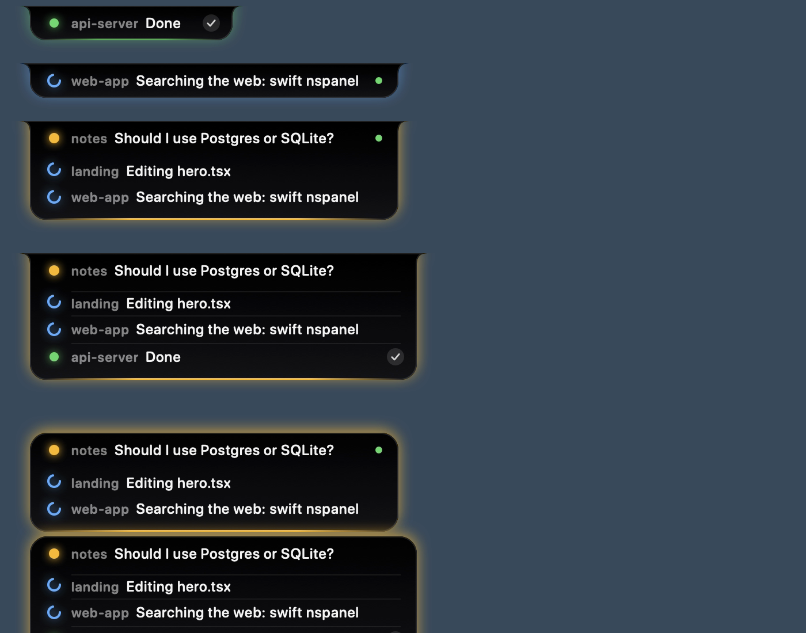

# AgentPill

A small always-on-top status pill for macOS that shows what your Claude agents are doing: Claude Code in any
terminal or editor, Code sessions in the Claude desktop app, and Claude desktop chats.



- **Blue spinner**: working, with time on the current step ("Running tests · 4m").
- **Amber dot**: needs you. The pill bounces and plays a soft chime.
- **Green dot**: done.
- Hover to see every session. Click a row to jump to that session or chat.

It uses no model tokens. It listens to Claude Code hooks and, optionally, reads the Claude desktop window
through Accessibility.

## Install

Needs macOS 12+ and the Xcode Command Line Tools.

```bash
git clone https://github.com/chetanvaswani/agentpill.git && cd agentpill
./make-cert.sh        # once, optional: keeps the Accessibility permission across rebuilds
./build.sh install
```

**Setting it up with a coding agent?** Point it at [AGENT_SETUP.md](AGENT_SETUP.md). It covers what the app
changes, permissions, verification, troubleshooting and uninstalling.
